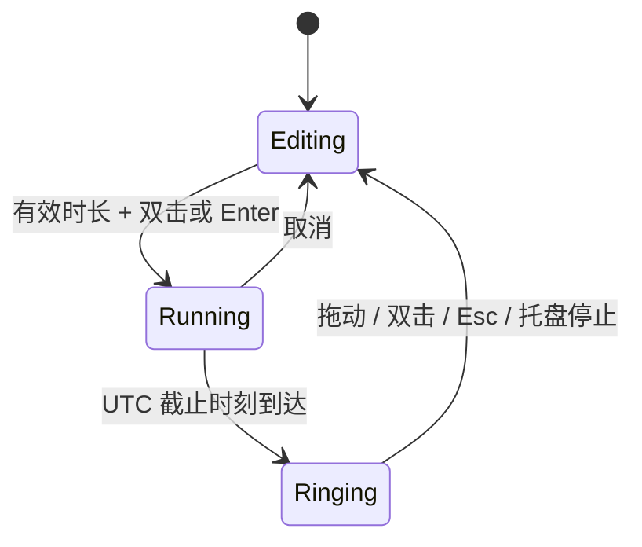

# 架构说明

## 运行模型

应用基于 .NET Framework 4.8 和 WPF。正式程序为 `Tomato.exe`，开发验证工具为独立的 `Tomato.Verify.exe`，避免将测试入口和预览生成逻辑放入用户程序。

`Program` 获取命名互斥锁，创建单一 WPF 应用，再把生命周期交给 `AppController`。托盘入口在番茄隐藏时仍然可用，关闭番茄窗口只隐藏，退出操作统一释放资源。

## 分层职责

| 层 | 职责与约束 |
| --- | --- |
| Domain | 倒计时、飞行物理、摇晃检测、逐格限频与拨轮阻尼运动；不依赖窗口或文件系统 |
| Infrastructure | XML 状态保存、偏好设置、预加载拨轮音效、可选触觉接口与 Windows 互操作 |
| Presentation | WPF 透明窗口、时间滚轮、保留绘图的动画层以及图像资源 |
| Application | 协调领域对象、窗口、托盘、提示音、显示器变化和持久化 |

分层使用目录表达职责，保留单一应用程序集与统一 `Tomato` 命名空间，避免为小型桌面应用引入不必要的容器和框架。测试通过公开动作和独立领域对象验证行为。

## 计时状态

200 毫秒的 UI 轮询用于观察 UTC 截止时间，不通过累积轮询次数计时。`Tick` 只产生一次到期状态转换。重启时从保存的截止时间恢复。系统时钟被人为调整仍会影响 UTC 截止逻辑，这是当前实现的明确边界。

## 交互与缩放

编辑窗口为220 × 220 DIP，设计画布仍为250 × 250 DIP并等比缩放，提醒窗口为250 DIP，专注时以右上角为固定点缩至125 DIP并淡化果实，隐藏编辑底板，仅显示倒计时。缩放使用画面变换，动画结束时一次性同步原生窗口的位置和尺寸；保存展开位置以避免重启偏移。鼠标命中判断在画布坐标中进行，拖动先将屏幕像素转换为DIP增量，摇晃检测使用屏幕DIP与单调时间。

到时在当前锚点恢复提醒大小，不重新定位到屏幕角落。每次投出时，将果蒂通过视觉树和屏幕物理坐标转换到投掷窗口坐标，因此发射点会跟随恢复动画；关闭投掷窗口时释放起点回调。

滚轮采用连续位置与整数目标值，拖动释放后承接速度并通过解析阻尼弹簧吸附。数字按圆柱角度投影到屏幕，纵向透视压缩并随边缘渐隐；数字排版、画笔与遮罩缓存复用。关闭系统动画时直接切换数字。时间列支持键盘输入和 UI Automation 的 RangeValue 模式。

显示数字跨过半格边界时发出独立的逐格事件；声音与触觉最多每 50ms 接受一次，不排队补播。三种 40ms PCM 在启动时合成并预加载，逐次轮换；开始计时前停止拨轮反馈，再由独立的到时提示音逻辑接管。程序赋值保持静音。

专注时，原编辑区隐藏并禁用拨轮，由单独的只读数字显示剩余时间，避免覆盖预设。取消或停止提醒后恢复原来的编辑时长。预设与截止时间沿用原 XML 字段；旧静音偏好用于首次初始化独立拨轮声音开关。

## 动画与清理

### 枝头待机

`IdleDeadline` 使用单调时钟检查 60 秒无操作，仅在编辑、可见、无鼠标捕获且设置关闭时允许挂回。键盘、滚轮、按下和移动鼠标会刷新期限。启动时若有有效倒计时或已到期提醒，优先恢复计时状态，不显示枝头待机。

`HangingMotion` 独立管理生长、接触、拉拽、回弹、挂回和脱落。`VineReach` 在开始时对可见曲线取 512 段弧长，按位移反查生长参数；`TravelTiming` 积分平滑的速度曲线，伸出时先加速、中段前进、最后制动，不直接缓动三次曲线参数。伸枝时长随路径长度在 0.55～3.2 秒之间变化；接触后执行 0.72 秒咬合与融合，期间果实保持原位，再承重 0.34 秒进入收枝。伸出和回收使用 30% 加速、5% 短高峰、65% 制动的时间分配，突出快慢反差。随后 `BranchReturn` 以 240Hz RK4 积分三维弹性牵引：接住时从零张力开始，重量使果实下坠并逐渐绷紧枝条，再缩短枝条静止长度，沿空间弧线收回。位置与恒定物体尺寸经过同一针孔相机投影，取样时也先插值空间坐标再投影。

`VineProjection` 将枝条控制点放在相机空间：根部位于远处，中前段拱过果蒂所在的深度平面，再回卷到果蒂；沿曲线投影中心、切线、带宽及叶片尺度。额外的平滑弯曲和末端回卷用于加强轮廓可读性，负载增加后逐渐拉直。这些形状控制是动画设计，不是枝条力学仿真。叶片节点随生长比例前移展开。`TomatoAttachment` 按素材实际 1254 × 1254 像素尺寸，将果蒂切面中心映射为统一连接点；果身以该点倾转，藤蔓最后一段平滑对齐变换后的果蒂轴向并收细，移除卷须和圆环。果身素材和编辑器快照均包含切面，故短段接缝在两者之后、果身倾转变换内绘制，并渐变融入原果蒂；离开接口时按枝梢距离连续淡出。中途摘取沿当前姿态释放。

果身侧向摆动跟随投影速度，俯仰和偏转由向远处的速度驱动并经过阻尼平滑；以图片变换和分层明暗近似体积转向，并非完整三维模型。叶片绘图和描边笔冻结缓存，枝条每帧取样一次供三层绘制共享；两种果身明暗共用一次透明遮罩。接住后先承重 0.22 秒，收枝时长随屏幕起点距离在 1.55～2.8 秒之间变化，独立采用 0.28 秒加速及 0.65 秒制动，最后预留 1.2 秒耗散残余惯性。靠近屏幕底边时减轻下坠，保持时序不变。`ReturnDuration` 是该次动作的实际时长，不再给不同距离套用固定总时间；托盘中断保留接触程度、俯仰、倾转和透明度，再连续恢复编辑器。

枝条起点取显示器完整边界的顶部，果实停靠位置仍避开任务栏；轨迹包围盒覆盖旋转果身。下拉原始位移达到 96 DIP 后才脱落，60 DIP 果实展开为 220 DIP；待机果实双击不展开，托盘和键盘入口保留。枝叶和果实整体使用 62% 不透明度，与相机深度连续关联，展开后恢复完全不透明。枝条以 32 段投影带状几何绘制，端点圆润；静止时不继续逐帧重建。

`IdleController` 保留原编辑窗口和时长，以一张冻结的编辑器快照衔接放大过程。`HangingWindow` 仅在阶段边界调整原生窗口范围，每帧只更新绘图；返回途中点击穿透，静止时收紧为小窗口，只有可见像素接收点击。鼠标捕获在脱落、松手、失去捕获和关闭时释放；静止和销毁时解除逐帧订阅。托盘展开可中断收回过程，显式开始、预设及提醒会先恢复编辑窗口。显示器变化重新计算工作区，不把动画途中坐标写入设置。

以下为到时投掷层的实现：

纹理启动时解码并冻结，飞行图像预缩小。每个活动番茄使用独立、可复用的 `DrawingVisual`，每帧只更新变换矩阵与透明度。物理以最多 16 毫秒的子步推进，长时间暂停后最多追赶 80 毫秒。

同时活动的果实上限为 36；落地仅反弹一次，寿命与边界条件负责回收。停止提醒会关闭透明窗口、解绑逐帧事件、清空粒子、停止提示音并注销 Esc。投掷窗口使用点击穿透和无激活样式。

首次触地反弹、第二次触地停留并在320ms内淡出。`Flight.Impacted` 每个物理步重置；`ThrowSurface` 只在实际投出及可见地面接触时发出 `FlightSoundEventArgs`，不另设音效计时器。碰撞力度使用碰撞前的垂直速度。

`ThrowFeedback` 启动时生成短促掠空声，并解码三个内嵌的CC0柔软碰撞PCM样本，按大小、速度、接触阶段和水平位置决定音量与声像。`EffectMixer` 使用16声部上限、复用混音缓冲及软限幅；首播等待超过100ms的事件直接丢弃，满载时优先保留碰撞。`NativeWaveOutput` 在独立线程使用三个10ms立体声缓冲，通过 Windows [WaveOut 事件回调](https://learn.microsoft.com/en-us/windows/win32/api/mmeapi/nf-mmeapi-waveoutopen) 输出。停止后 reset、归还缓冲并关闭设备；UI最多等待200ms，不被故障驱动无限阻塞。设备失败时不影响计时和动画。旧版到时静音偏好初始化独立的投掷音效开关。

## 构建与发布

`scripts/build.ps1` 以编译警告为错误，分别生成正式应用和验证程序；Release 不生成含本机路径的 PDB。Visual Studio 工程与脚本共用同一套源文件、资源、清单和应用配置。

`scripts/package.ps1` 执行验证、渲染与白名单打包，输出 SHA-256。`scripts/check-package.ps1` 对压缩包入口与哈希再次检查。GitHub CI 使用只读仓库权限与固定提交的 Actions，避免在拉取请求中获得发布权限。

Windows 的 `v<版本>` 标签和 macOS 的 `macos-v<版本>` 标签分别触发正式版与预览版发布。发布流程先核对标签与平台版本文件，再完成构建、测试、制品校验和 SHA-256，最后建立 GitHub Release；每个后续 Release 附带包含源提交、工作流和制品哈希的机器可读证据。人工台账见 [`docs/RELEASES.md`](RELEASES.md)。仓库不存储签名证书，也不自动合并依赖升级；商业分发仍需另行确定许可证、代码签名、公证和硬件验收方案。

Windows 登录启动由 LoginStartup 策略与可注入的注册表适配器分离管理。正式入口才注入当前用户 Run 项；验证入口使用内存适配器，避免污染日常启动设置。默认仅尝试一次，外部移除不自动恢复，升级只更新仍存在的路径；不改写 Windows StartupApproved 状态。

## 界面语言

`Texts` 以稳定键管理中英文文本，同一份代码编译进主程序和独立安装器，不依赖网络或额外语言包。`Preferences.Language` 支持 `system`、`en`、`zh-CN`；旧 XML 缺失该字段时跟随系统，中文 UI culture 使用简体中文，其他语言回退英文。

语言变更只刷新现有番茄窗口的文字与无障碍名称、托盘状态及设置内容；不重建番茄窗口、重置领域时钟或替换投掷动画。设置面板保持同一窗口，只有内容重建。安装器独立保存本次会话的语言选择，刷新现有控件文字，保留路径与复选框状态。系统原生文件夹对话框不修改 Windows 语言。

### 藤蔓芽头与咬合

`BudBite` 用绝对时间编排靠近张嘴、0.18 秒合嘴、停顿至 0.28 秒、随后 0.44 秒融入果蒂。`VineBud` 绘制原生矢量芽头，后部头型／嘴腔在果实之前，近侧下颌在果实之后，使果蒂进入嘴内。脸颊先保持实体并收细，五官逐渐消退，仅最后的细小部分淡入现有接缝。藤蔓末段随芽头变形连接其后脑位置，避免穿过脸颊。中途展开保存表情状态，并在藤蔓撤离期间淡出；静止待机不保留面孔。矢量绘图不引入外部游戏素材或新的图片资源。
